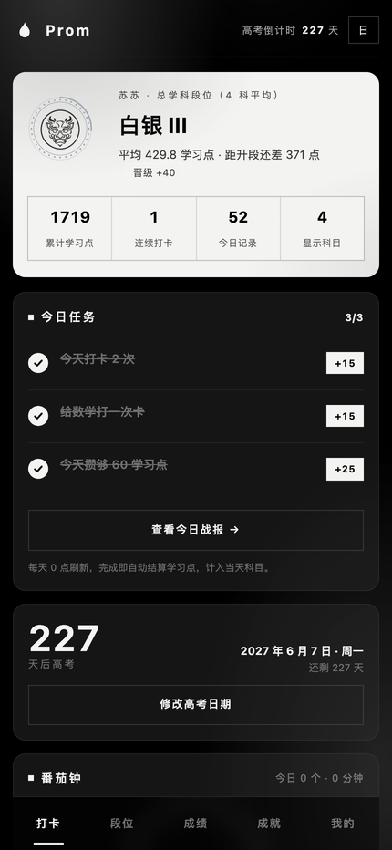
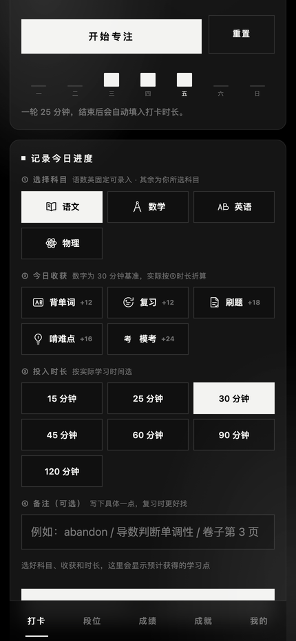
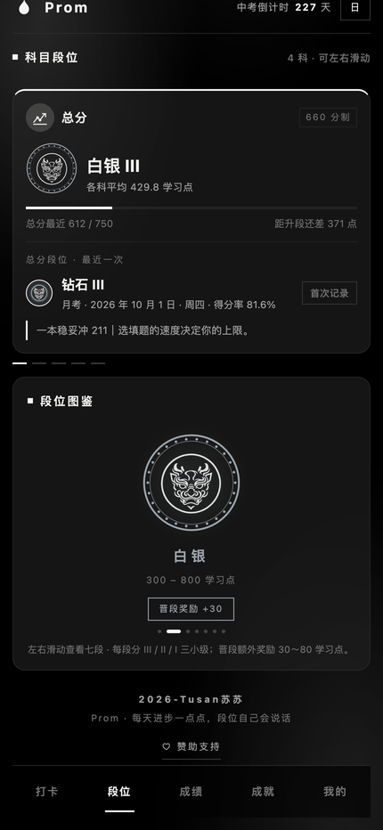
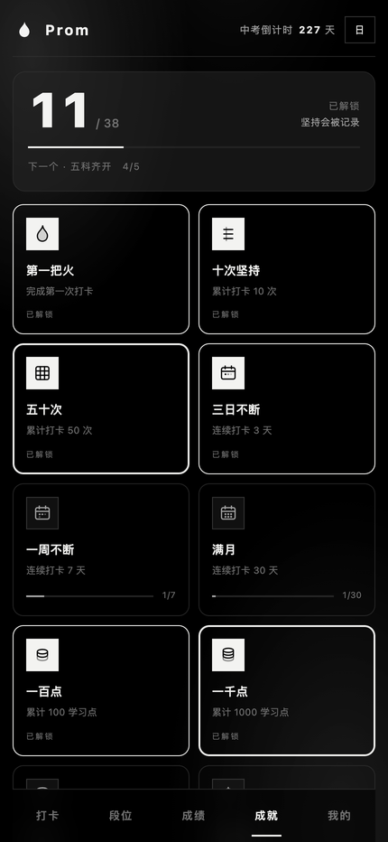

# Prom

**把每天的努力，记成一笔账。**
*A 281 KB Android app that turns daily effort into a ledger.*

[**▶ 在线试用 / Live demo**](https://tusan-su.github.io/prom-studyrank/)　·　[下载 APK / Download](https://github.com/TusanSu/prom-studyrank/releases)　·　[MIT](LICENSE)

<p align="center">
  
  
  
  
</p>

---

## 这个应用在解决什么 / What it is about

学习是件**回报很晚**的事。今天背的单词，三个月后才出现在卷子上；今天弄懂的题，可能一年都用不上。人的动力系统不擅长这种长周期——它要的是**今天做了，今天就有回应**。

多数人不是不努力，是努力太久没有反馈，于是算了。

Prom 在「努力」和「回报」之间，补上当天的那一次回应。

> Studying pays off late. Words memorised today show up on an exam three months from now.
> Human motivation is bad at that delay — it wants *something today, for what you did today*.
> Most people don't quit because they're lazy. They quit because nothing came back.
> Prom puts a small response back into that gap, every day.

## 它怎么工作 / How it works

**1 · 打卡 / Check in**

选科目、记收获（背单词 / 复习 / 刷题 / 啃难点 / 模考）、填时长，折算成学习点。三十秒一笔，睡前也能补。

*Pick a subject, tag what you did, enter the minutes. Converted into points. Thirty seconds, any time.*

学习点不是简单计时：

- 科目有不同权重
- 同一科目一天内多次打卡，第三笔起收益递减
- 连续打卡有加成
- 每日有上限，超过后衰减

**2 · 七重境界 / Seven tiers**

学习点从「一重·天枢」累积到「七重·摇光」，对应北斗七星。每一重分 **下 / 中 / 上** 三小级。

*Points climb from **Tier I · Tianshu** to **Tier VII · Yaoguang**, named after the seven stars of the Big Dipper. Each tier has three steps.*

**3 · 龙瞳 / The dragon's eyes**

同一张龙面，七种瞳色——灰、褐、青、碧、金、赤、白热。境界越高，眼睛越亮。

*One dragon face, seven eye colours — ash, amber, cyan, jade, gold, crimson, white-hot. The higher the tier, the brighter the gaze.*

**4 · 战报 / Report**

每天一页：投入多久、赚了多少、连续第几天。

**5 · 番茄钟 / Pomodoro**

25 分钟专注，结束后自动记进当天打卡。

**6 · 成就 / Achievements**

35 枚成就，另有 4 个隐藏彩蛋，触发后才会亮起。

**7 · 双学段 / Two school stages**

初中、高中两套独立体系：科目、满分、中考 / 高考倒计时都跟着切换，地区满分可预设。

## 隐私与体积 / Privacy & footprint

| 项 / Item | 情况 / Status |
|---|---|
| 安装包 / APK size | **281 KB** |
| 网络权限 / Network permission | **不申请 / none** |
| 账号 / Account | **不需要 / not required** |
| 云端 / Cloud | **没有 / none** |
| 广告与统计 / Ads & analytics | **没有 / none** |

数据全部存在手机本地。换设备时用「用户卡」生成一段密钥，粘贴到新设备即可恢复——**不经过任何服务器**。

*Everything stays on the device. To move to a new phone, export a key string and paste it — no server involved.*

## 技术 / Under the hood

- **主体**：单文件 WebView 应用，界面与逻辑都在 `app/src/main/assets/index.html`
- **原生层**：5 个 Java 类（WebView 宿主、每日提醒、番茄钟通知、开机恢复）
- **权限**：4 个，全部与提醒、振动有关
- **图形**：无位图素材包，徽章、龙面、图表全部由 SVG / Canvas 现画

*Single-file WebView app. Five Java classes for the native shell. Four permissions, all about reminders.
No bitmap asset packs — badges, dragon and charts are all drawn in SVG/Canvas at runtime.*

## 构建 / Build

需要 Android SDK（build-tools 34+，platform android-34）。

```sh
# 方式一：不依赖 Gradle
./build-apk.sh

# 方式二：Gradle
./gradlew assembleRelease
```

输出：`build/apk/StudyRankApp-12.8-release.apk`

> 签名需要你自己的 keystore —— 仓库里不含任何密钥文件。
> *Signing needs your own keystore. No keys are included in this repo.*

## 目录 / Layout

```
app/
├─ build.gradle                    versionCode 47 / versionName 12.8
└─ src/main/
   ├─ AndroidManifest.xml          4 个权限
   ├─ assets/index.html            界面与逻辑（单文件）
   └─ java/com/studyrank/app/      5 个 Java 类
docs/                              GitHub Pages 在线演示
├─ index.html                      落地页（手机框内嵌 App）
└─ app.html                        App 本体，浏览器可直接运行
```

## 版本 / Version

**12.8** — 境界更名「一重·天枢 → 七重·摇光」，徽章加入龙瞳配色。

## 许可 / License

[MIT](LICENSE) © 2026 Tusan苏苏
